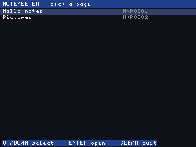
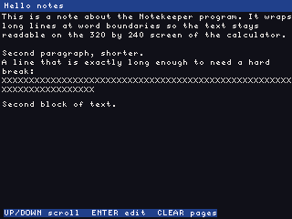
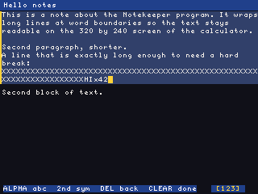
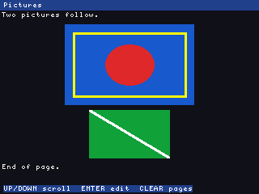

# Notekeeper for the TI-84 Plus CE (native eZ80 assembly)

`NOTES.8xp` is a native program for the TI-84 Plus CE / TI-83 Premium CE family. It reads **pages made of
text and pictures**, shows them on the 320x240 colour screen, and lets you **edit them on the calculator**.

| Page list | Reading | Editing text | Pictures |
| :---: | :---: | :---: | :---: |
|  |  |  |  |

## Getting it onto a calculator

1. **Native programs must be allowed to run.** Older OS versions run them as-is. Newer OS versions block them;
   [arTIfiCE](https://github.com/YvanTT/arTIfiCE) (which installs [AsmHook2](https://github.com/RoccoLoxPrograms/AsmHook2))
   restores that - follow its instructions, they change with each OS release.
2. With TI Connect CE, send `dist/NOTES.8xp` and the page files (see below). Try `samples/*.8xv` first.
3. Press <kbd>prgm</kbd>, pick `NOTES`, <kbd>enter</kbd>.

## Making pages

*Web tool (easiest):* open `index.html` in the repo root, load or write pages (text and images), then
notebook <kbd>...</kbd> menu -> **Export for TI-84 CE (.zip)**. Unzip and send every `.8xv` file.

*Command line:* `python3 tools/nkpack.py OUTDIR notes.txt chapter.md photo1.png photo2.png`
(needs Python 3 + Pillow). Text files become pages (a `.md` with several `# Headings` becomes one page per heading,
a single leading `# Title` becomes the page title); all images together become one page. Add `--archive` to
mark the files for the archive.

## Keys

| Where | Key | Action |
| --- | --- | --- |
| Page list | <kbd>up</kbd> <kbd>down</kbd> / <kbd>enter</kbd> / <kbd>clear</kbd> | select / open / quit |
| Reading | <kbd>up</kbd> <kbd>down</kbd> | scroll 2 lines |
| | <kbd>left</kbd> <kbd>right</kbd> | scroll a screenful |
| | <kbd>enter</kbd> / <kbd>clear</kbd> | edit this page / back to the list |
| Editing (blocks) | <kbd>up</kbd> <kbd>down</kbd> | choose a block (text or picture) |
| | <kbd>enter</kbd> | edit the text of a text block |
| | <kbd>+</kbd> | new empty text block after this one |
| | <kbd>del</kbd> then <kbd>enter</kbd> | delete the block (any other key cancels) |
| | <kbd>(</kbd> <kbd>)</kbd> | move the block up / down |
| | <kbd>clear</kbd> | **save** and go back to reading |
| Typing | arrows | move the caret (up/down follow wrapped lines) |
| | <kbd>alpha</kbd> | cycle `123` -> `ABC` -> `abc` (shown bottom right) |
| | <kbd>enter</kbd> / <kbd>del</kbd> | new line / backspace |
| | <kbd>0</kbd> in ABC/abc, <kbd>vars</kbd> always | space |
| | <kbd>2nd</kbd> + key | symbol: `.`=`:` `,`=`;` `(`=`[` `)`=`]` `+`=`"` `-`=`_` `x`=`'` `/`=`!` `^`=`%` `(-)`=`#` `sto`=`&` `math`=`<` `apps`=`>` `prgm`=`{` `1/x`=`}` `0`=`@` `vars`=`~` |
| | <kbd>clear</kbd> | back to block selection |

In `123` mode the keys give their printed digit or `. , ( ) + - * / ^`, `(-)` gives `?` and `sto` gives `=`.

## How it stores things

Everything is an ordinary appvar, so TI Connect CE and the memory menu see it:

```
NKIDX     count(1) { appvar name(8)  title(24) } * count                      (<= 40 pages)
NKPxxxx   "NKP1" nblocks(1) title(24) pcount(1) palette(pcount*2, 1555)  blocks...      (<= 60000 bytes)
            block 01  len(2) bytes...            text, ASCII, 0Ah = new line  (<= 4000 bytes, <= 255 blocks)
            block 02  w(2) h(2) name(8)          picture stored in appvar `name`
NKIxxxxn  w*h raw 8-bit pixels (palette indexes 16..255), <= 320x200, one shared 240-colour palette per page
```

Pictures are only ever *read* (straight from the archive, never copied to RAM), so they can stay archived.
When you save an edited page it is rewritten as a RAM appvar of the same name; archive it again from the
memory menu if you like. Deleting a picture block does not delete its `NKIxxxxn` appvar.

## Build and test (no calculator or ROM needed)

```
test/setup.sh                  # builds spasm-ng (assembler) + the CEmu core + test harness into test/.tools
./build.sh                     # src/notes.asm -> dist/NOTES.8xp
SPASM=test/.tools/spasm-ng/spasm SPASM_INC=test/.tools/spasm-ng/inc NK_HARNESS=test/.tools/harness \
  python3 test/run_tests.py    # 22 tests
```

The tests run the real `NOTES.8xp` machine code inside the [CEmu](https://github.com/CE-Programming/CEmu) core
(a cycle-accurate eZ80 / CE hardware emulator): `test/harness.c` loads the program into RAM, feeds scripted key
presses, and stands in for the handful of OS routines the program calls (`_GetCSC`, `_ChkFindSym`, `_ChkInRam`,
`_EnoughMem`, `_CreateVar`, `_DelVarArc` and the screen-restore calls). The tests then read text back out of
the emulated frame buffer and parse the appvars the program saved. They include

* word wrap on 36 random texts, compared with an independent Python implementation of the wrap rules,
* 300 random editing key presses (move, type, newline, backspace) compared with a Python model,
* images through the page palette, scrolling and caret following, blocks insert/move/delete,
  the 255-block and 4000-byte limits, out-of-memory saving, archived and RAM appvars, a 40-page list,
* the web exporter and `nkpack.py` producing identical bytes, and the full chain
  web app (headless Chromium) -> exported zip -> emulator.

### What this does *not* prove

I have not run it on a physical calculator, and the emulator runs without a TI OS ROM. The OS routines are
stand-ins written from how the CE toolchain's `fileioc` library calls the real ones (including the layout of
archived variables), so a mismatch with a real OS is the most likely source of a surprise. If something
misbehaves on hardware, please open an issue with the OS version and what happened.

## Notes

* `IY` is never touched (the OS keeps its flags there), the LCD is returned to 16 bpp on exit, and all working
  memory is the unused half of the 8 bpp frame buffer (`D52C00h..D65800h`), so the program file is only ~6 KB.
* The 6x9 font is generated by `tools/gen_assets.py` from the public-domain X11 "misc-fixed" glyphs.
* spasm-ng and CEmu are only used to build and test; nothing from them is shipped in `dist/`.
